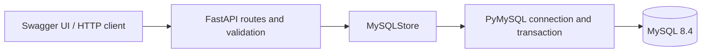

# Task Service API

一个用 FastAPI 和 MySQL 实现的任务与事件 API，从已在腾讯云 Ubuntu 上验证过的后端课程实验整理而来。核心示例是把任务和创建事件写入同一事务，再用事件 ID 游标读取事件。



## 快速启动

安装 Python 3.12 和 Docker Compose，在仓库根目录运行。

```sh
python setup_env.py
docker compose up --build --wait --wait-timeout 180
```

打开 [Swagger UI](http://127.0.0.1:18016/docs)，在 `POST /tasks` 提交 `{"title":"Review API design"}`。复制返回的 ID，依次执行详情查询和事件查询。也可用 curl 创建任务。

```sh
curl -fsS http://127.0.0.1:18016/tasks \
  -H 'Origin: http://127.0.0.1:18016' \
  -H 'Content-Type: application/json' \
  -d '{"title":"Review API design"}'
```

| 接口 | 用途 |
| --- | --- |
| `GET /health` | 检查 API 进程是否响应 |
| `GET /ready` | 检查数据库会话、TLS 和表结构 |
| `POST /tasks` | 同事务创建任务与首条事件，返回 201 |
| `GET /tasks/{id}` | 查询任务及事件数量 |
| `GET /tasks/{id}/events?after_id=0&limit=20` | 按事件 ID 游标分页 |

`docker compose down` 停止服务并保留数据库卷。首次启动会初始化卷，后续启动复用已有数据和对应的 `.env`。

## 验证

```sh
python -m pip install -r requirements-dev.txt
python -m pytest -q
# bash
docker compose exec -T api python - < tests/mysql_smoke.py
```

PowerShell 中可用 `Get-Content tests/mysql_smoke.py -Raw | docker compose exec -T api python -` 运行同一个检查。单元测试覆盖 API 校验、错误映射及事务调用顺序。真实 MySQL 脚本检查任务写入、参数化查询、游标、约束失败后的回滚，以及从新连接读取结果。CI 还会重建数据库容器，核对同一个任务在重建前后的响应。

## 实现取舍

- 使用同步 PyMySQL 和同步路由。每次存储操作建立并关闭连接。
- API 默认仅绑定回环地址，MySQL 只连接 Compose 内部网络。写请求要求同源 Origin 和 JSON。应用没有用户认证，部署演示以本机或 SSH 隧道访问为准。
- MySQL 强制 TLS。本地 Compose 使用 MySQL 自动生成的证书，默认连接加密但未验证服务端身份。如需校验身份，给 API 容器配置 `MYSQL_CA_FILE` 并挂载可信 CA，MySQL 服务端证书需要匹配主机名 `db`。
- 创建任务没有 HTTP 幂等键。如果提交后连接中断，客户端无法仅凭错误响应判断写入是否成功。
